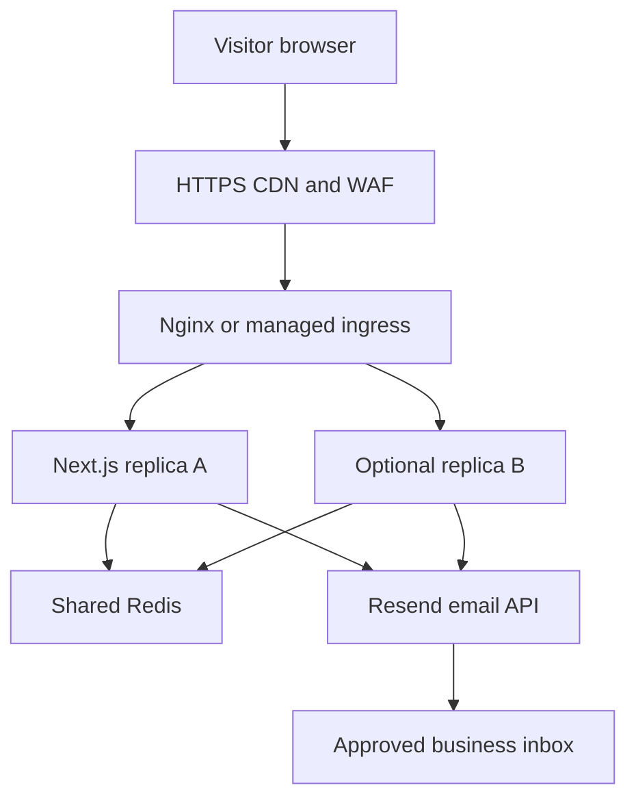

# Deployment and recovery

## Two supported targets

1. **Portable production:** Next.js standalone Node container. This is the Docker target and the recommended path for independently managed hosting. Use an HTTPS load balancer or ingress, one or more app replicas and one shared Redis. No sticky sessions are required.
2. **ChatGPT Sites:** the same App Router source uses Vinext and the preserved Sites Vite integration to run on Workers. The `.openai/hosting.json` project ID is the canonical Site identity. Managed edge connections use Upstash REST; do not set `REDIS_URL` on Workers, where raw TCP is not the supported path.

For Sites, Workers replaces the Nginx/replica tier. The API gateway is the `/api/*` policy at the ingress and app, not a separate microservice.

## Configure and launch

- Confirm final domain, image rights, exact business details, privacy text, WhatsApp account and recipient email.
- Create a restricted Resend send key and verify the sender domain. Configure SPF/DKIM as instructed by the provider; check the actual inbox delivery with an explicitly authorised test.
- Configure shared Redis and a random HMAC secret. Do not use an in-memory fallback on replicated production.
- Set the environment variables in README. Configure both Turnstile keys together if enabled. Test normal submission, suspicious traffic, failed challenge and expired token states.
- Deploy a non-indexable staging build. Run health, page, form and browser checks against that exact image.
- Configure TLS at ingress. Set the application origin exactly. Route public traffic only through the trusted ingress; do not expose port 3000 or Redis publicly.
- Set `TRUSTED_PROXY=nginx` only where the supplied ingress overwrites `X-Real-IP`; use `cloudflare` only when Cloudflare is the trusted direct ingress. Do not trust arbitrary client forwarding headers.
- If a CDN sits before Nginx, configure `set_real_ip_from` with the vendor's current exact network ranges and its authenticated source-IP header. Do not use `0.0.0.0/0`. Set `X-Forwarded-Proto` from the trusted TLS terminator, not arbitrary request headers.
- For managed replicas, route `/api/health` readiness/liveness checks. A healthy process does not certify an email provider; separately alert on submission failure rate.
- Promote the immutable tested image digest with a protected production environment. Enable indexing and rebuild after final content approval.

## Caching

Framework-hashed static assets use immutable caching. Source-named public images use a one-day TTL with a one-week stale-while-revalidate window; rename/revision filenames or purge the CDN when changing them. HTML uses request-specific CSP nonces and is **not shared-cacheable** (`private, no-store`), deliberately avoiding nonce reuse. Contact POST, health, PII and private content are never cached. There is no ISR content cache to invalidate. A later CMS/ISR migration must redesign the nonce/cache policy and shared revalidation together.

## CI and environments

Configure GitHub `staging` and `production` environments; require a reviewer for production and restrict deployment branches to protected main. Set repository branch rules requiring the quality/security workflow and reviewed pull requests. The connected GitHub tool in this session does not expose branch-protection writes; these account settings must be applied by the repository owner.

GHCR login uses the scoped `GITHUB_TOKEN`. Production providers with OIDC should use a host-specific OIDC deployment job. The included provider-neutral alternative accepts a narrowly scoped deployment webhook token in environment secrets. `DEPLOYMENT_ENABLED=true`, `DEPLOY_WEBHOOK_URL` and `DEPLOY_WEBHOOK_TOKEN` activate that step; without them the workflow builds an image and records its digest, it does not claim a host deployment. The webhook must accept `{image,digest}` and perform an atomic deployment/health check.

## Rollback and recovery

Keep the previous successful GHCR digest. If health, visual or form checks fail, redeploy that digest and purge changed mutable image URLs. Never reuse a mutable `latest` tag as the sole rollback record. For Sites, deploy the previous saved version without editing the project identity.

Git plus original supplied assets is the source backup. Redis contains only ephemeral anti-abuse/replay state; loss may permit a duplicate attempt, although Resend idempotency persists for the provider window. Mailbox retention and backups are the owner's responsibility and must be agreed before launch. There is no lead-database backup to promise.

Rotate email, Redis, webhook and HMAC secrets in the host secret store. Revoke old keys after a successful health/form test. HMAC rotation invalidates old rate identifiers; monitor abuse during the short reset window.

## Verification limits here

No Docker executable or hosting-domain credentials were available. Docker runtime, container scan and external staging/production promotion are configured but not asserted as executed. See `qa.md` for the measured checks and browser limitations.
